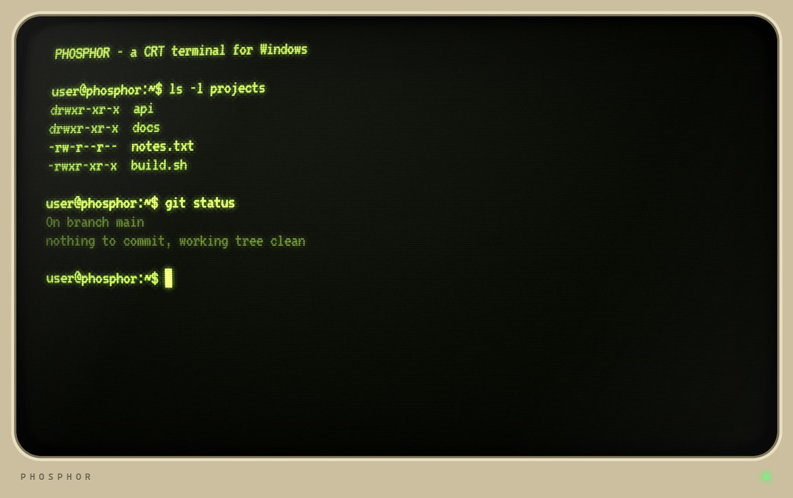
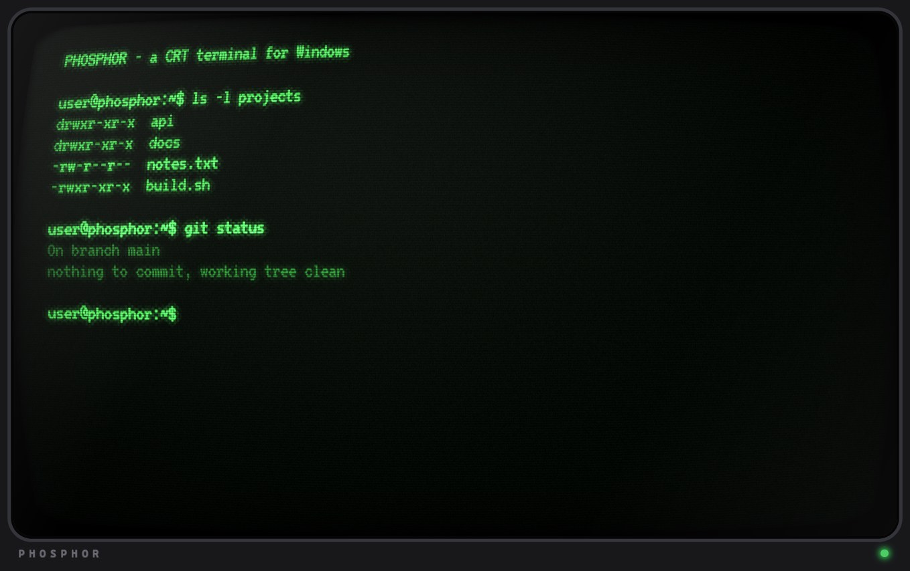
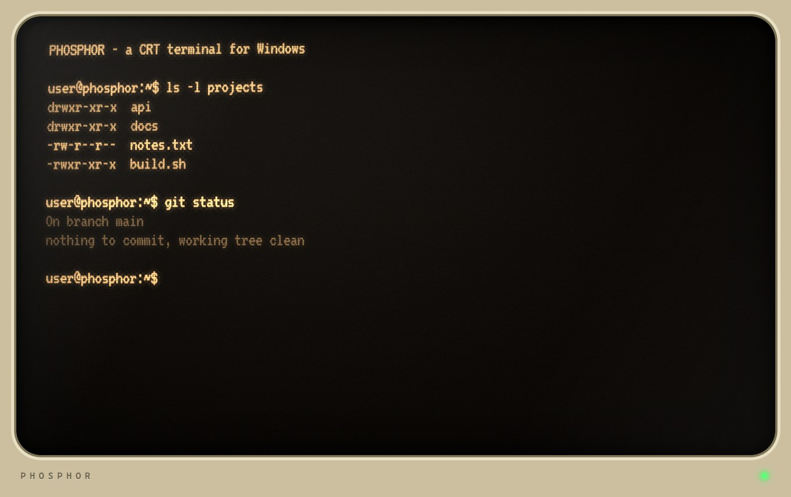
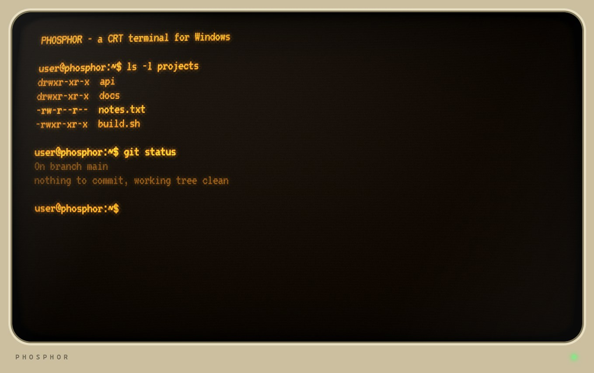
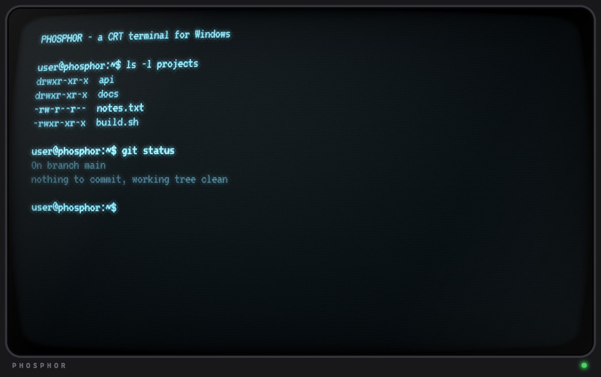
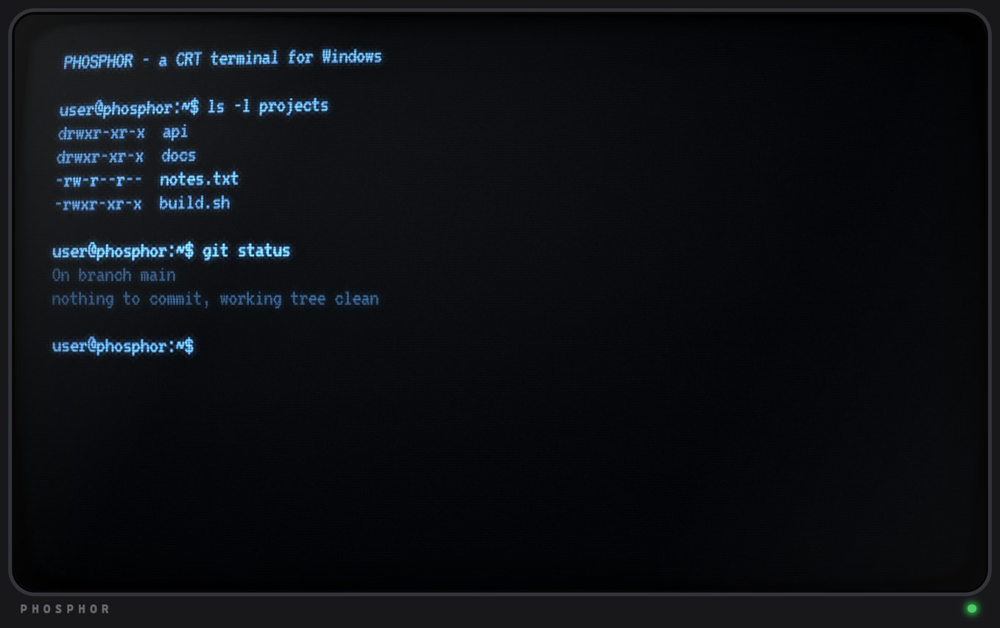
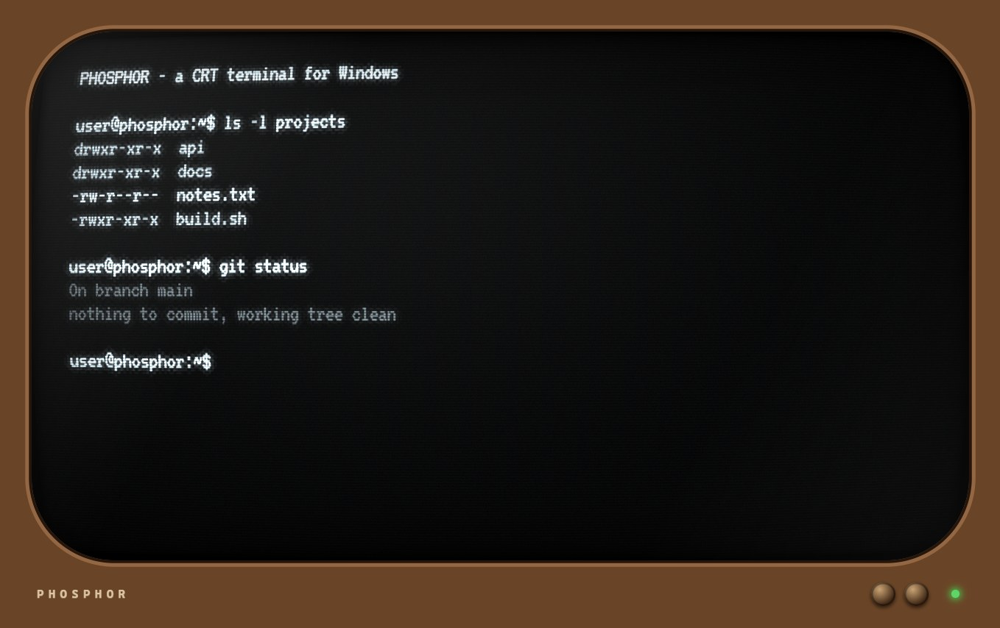

[English](README.md) | **Español** | [Русский](README.ru.md)

# PHOSPHOR

**Una terminal CRT para Windows.** Fósforo simulado con persistencia y burn-in, scanlines, curvatura de tubo, diez skins, marcos de monitor opcionales, secuencia de arranque, sonidos sintetizados y un modo de velocidad de módem. Corre PowerShell, o cualquier comando que le pases, como [Claude Code](https://claude.com/claude-code).



PHOSPHOR es una app chica en Electron: [xterm.js](https://xtermjs.org/) dibuja la terminal, [ConPTY](https://learn.microsoft.com/windows/console/creating-a-pseudoconsole-session) (con `@lydell/node-pty`) ejecuta el shell, y un shader WebGL convierte cada cuadro en un tubo de vidrio. Está inspirada en [cool-retro-term](https://github.com/Swordfish90/cool-retro-term), que no tiene versión para Windows.

## Skins

Cada skin define el color del fósforo y todos los efectos, y elige un marco de monitor. Cambiá de skin con **F10** o con **Alt+Shift+Izquierda/Derecha**.

| | |
|---|---|
|  **Atomic**: verde retrofuturista, scanlines marcadas, burn-in |  **Sepia**: cálida, aspecto de papel, efectos suaves |
|  **Amber 80s**: monocromo ámbar clásico |  **Cool Cyan**: resplandor cian frío |
|  **IBM Blue** |  **White P4** con el marco de TV retro |

También incluye: **Green P1** (por defecto), **Claude** (naranja), **Color** (conserva los colores de tu terminal) y **Clean** (casi sin efectos).

## Características

- **Fósforo:** persistencia (la luz se apaga de a poco), burn-in (un fantasma tenue de lo que quedó en pantalla), resplandor, suavidad, brillo del vidrio, esquinas redondeadas y animación de encendido.
- **Tubo:** curvatura, scanlines, máscara de apertura, viñeta, parpadeo, inestabilidad horizontal, barra de refresco y una ondulación de desmagnetizado al cambiar de skin.
- **Marcos de monitor** (opcionales): Beige 80s, Negro y TV retro, dibujados en CSS con un LED de encendido.
- **Secuencia de arranque** (opcional): unas líneas de texto estilo BIOS. Cualquier tecla la saltea.
- **Sonido** (opcional, sintetizado, sin archivos de audio): clics de teclado, zumbido de CRT y barrido de encendido.
- **Velocidad de salida:** limita la salida de la terminal como una línea serie lenta (presets de 300 a 19200 baudios). Si se acumula mucho texto, se vacía más rápido y nunca queda minutos atrasada.
- **Modo Comfort:** quita parpadeo, inestabilidad, ráfagas de ruido y destellos para sesiones largas.
- **Controles de rendimiento:** tope de cuadros por segundo y calidad de render (ver abajo).
- Copiar y pegar (**Ctrl+C** copia si hay texto seleccionado, **Ctrl+V** pega), portapapeles OSC 52 para aplicaciones, exportar PNG y pantalla completa.
- Todos los ajustes se guardan solos.

## Cómo ejecutarla

Requiere Windows 10/11 y [Node.js](https://nodejs.org/) 18 o superior.

```powershell
git clone https://github.com/GabrielAmbrosio/phosphor.git
cd phosphor
npm install
npm start
```

- `npm start` abre PowerShell.
- `npm run claude` abre Claude Code (sirve cualquier comando: `npx electron . <comando>`).
- Doble clic en `phosphor.cmd` o `phosphor-claude.cmd` para lo mismo sin ventana de consola.
- `--phosphor-cwd=C:\alguna\carpeta` define el directorio inicial.

### Crear un instalador

```powershell
npm run dist        # instalador NSIS + exe portable en dist/
npm run dist:dir    # app sin empaquetar en dist/win-unpacked
```

La app usa el ícono por defecto de Electron hasta que agregues uno (`build/icon.ico`).

## Controles

| Tecla | Acción |
|---|---|
| **F10** | Panel de ajustes: skins, marco, sliders, sonido, velocidad |
| **F11** | Pantalla completa |
| **F12** | Guarda la pantalla CRT como PNG en tu carpeta Imágenes |
| **Alt+Shift+Izquierda/Derecha** | Skin anterior / siguiente |
| **Ctrl+C / Ctrl+V** | Copiar (con selección) / pegar |
| Cualquier tecla | Saltea la secuencia de arranque |

## Rendimiento

La pantalla solo trabaja cuando hace falta:

- Un **tope de cuadros por segundo** (30 por defecto, 10 mientras la ventana no tiene el foco).
- La terminal se copia a una textura de GPU **solo cuando cambió**; una pantalla estática sin efectos animados (por ejemplo la skin Clean) saltea casi todos los cuadros.
- La pasada de **persistencia** se detiene cuando el fantasma se desvaneció, y el **burn-in** corre a 10 Hz y solo si está activado.
- El shader usa **14 lecturas de textura** por píxel.
- La **calidad de render** (100 / 75 / 50 %) cambia nitidez por tiempo de GPU y memoria.

Medido en Windows 11, Electron 33, ventana de 1100x720, terminal quieta, sumando todos los procesos de Electron (`PHOSPHOR_STATS=1`; los números varían cerca de un 15 % entre corridas):

| Configuración | Cuadros dibujados por segundo | Memoria (todos los procesos) |
|---|---|---|
| Primera versión, sin tope | cerca de 100 | 550 a 740 MB |
| Por defecto, tope de 30 fps | cerca de 28 | cerca de 520 MB |
| Skin Clean (nada animado) | cerca de 4 | cerca de 490 MB |
| Calidad 50 %, ventana sin foco | cerca de 10 | cerca de 440 MB |

Unos 270 MB de eso son la base de Electron (procesos de navegador, utilidad y renderizado); el proceso de GPU es lo que cambian estos ajustes.

## Cómo funciona

1. xterm.js dibuja la terminal en canvas 2D que quedan invisibles pero reciben teclado y mouse.
2. Cuando xterm avisa que repintó, los canvas se componen y se suben como textura WebGL.
3. La pasada 1 mezcla el cuadro nuevo con el anterior (persistencia). La pasada 2 guarda un fantasma muy lento (burn-in). La pasada 3 dibuja la pantalla: curvatura, resplandor, scanlines, máscara, ruido, viñeta y vidrio redondeado.
4. El marco del monitor es CSS simple dibujado encima.

Todo está en cuatro archivos: [`main.js`](main.js) (ventana, pty), [`preload.js`](preload.js), [`renderer.js`](renderer.js) (terminal, shaders, panel) e [`index.html`](index.html).

## Pruebas y capturas

- `npm run shots` regenera las capturas en `docs/img/`, una ventana por skin.
- Modo de prueba: `PHOSPHOR_SHOT=salida.png` guarda una captura de la ventana y sale; `PHOSPHOR_STATS=1` imprime memoria y CPU por proceso; `--phosphor-fps=1` registra cuadros dibujados y salteados.
- Si lanzás la app desde otro programa Electron (por ejemplo la terminal de VS Code), limpiá antes `ELECTRON_RUN_AS_NODE`; los lanzadores `.cmd` ya lo hacen.

## Créditos

- Inspirada en [cool-retro-term](https://github.com/Swordfish90/cool-retro-term) de Filippo Scognamiglio ([@Swordfish90](https://github.com/Swordfish90)). PHOSPHOR no usa nada de su código.
- Fuente: [VT323](https://fonts.google.com/specimen/VT323) de Peter Hull, bajo la SIL Open Font License (ver [`fonts/OFL.txt`](fonts/OFL.txt)).
- Hecha con [Electron](https://www.electronjs.org/), [xterm.js](https://xtermjs.org/) y [node-pty](https://github.com/microsoft/node-pty).
- No está afiliada a ninguna empresa cuyo software ejecutes adentro.

## Licencia

[MIT](LICENSE)
